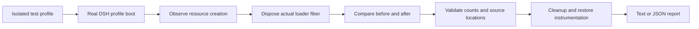

# Cordis Unload Hygiene Probe

**A reproducible diagnostic prototype for DeepSeek Harness (DSH) plugin lifecycle cleanup.**

Prototype v0.1.0 · Windows · Node.js · Real DSH runtime

[日本語](README.ja.md) · [Roadmap](ROADMAP.md) · [Architecture](docs/architecture.md) · [Validation](docs/validation.md)

## Why this project exists

A plugin can appear to unload successfully while timers or listeners remain active. Repeated load/unload cycles can then leave unintended work behind. Finding the allocation site is difficult when cleanup problems only appear at runtime.

This project demonstrates a way to count selected resources before and after **actual Cordis loader fiber disposal**, identify their creation sites, and produce repeatable diagnostic evidence. The goal is a practical quality-assurance tool for DSH plugin developers, not a general memory profiler.

## What works today

- Boots a real, locally installed DSH profile containing a trusted project-owned fixture.
- Tracks global intervals, global timeouts and listeners on a dedicated test EventEmitter.
- Reports before/after counts and project-relative source file, line and column.
- Compares a correctly managed fixture with an intentionally leaking fixture.
- Produces human-readable output and versioned JSON; validates expected exit codes.
- Cleans up the controlled residual resources and restores the instrumentation.
- Reproduces the result on a fresh Windows VM with independently installed DSH.

**This is a fixed-fixture proof of concept, not an installable general-purpose DSH diagnostic plugin.** Arbitrary plugins, production profiles and Desktop GUI integration are not supported.

## How it works



## Verified results

| Controlled fixture | Trials passed | Tracked resources remaining immediately after disposal |
| --- | ---: | ---: |
| Clean | 6/6 | 0 |
| Intentional leak | 6/6 | 18 total (3 per trial) |

Reproduced in a fresh Windows 11 25H2 VM on the same physical host, using separately installed DSH Desktop 0.31.3 and Node.js v24.18.0 x64. The 18 resources in the intentional-leak group were detected before test cleanup; all completed trials verified cleanup and instrumentation restoration. These are controlled fixture results, not measured real-world accuracy or independent third-party hardware compatibility.

See [validation details](docs/validation.md) and the [JSON example](examples/both.json).

## Quick start

Requirements:

- Windows x64, Node.js (tested with v24.18.0).
- DSH Desktop installed locally in the supported Windows layout. Complete its first-launch runtime/package initialization before running the demo. Initial installation may require a network connection.
- A normal writable project directory. The launcher checks the expected local DSH runtime and archive paths, rejecting unsupported or redirected layouts.

No npm package installation, sign-in to DSH, API key or paid model call was required for the diagnostic tests after DSH initialization. DSH itself is separately distributed and is **not bundled** here.

From the project root:

```powershell
node scripts/diagnose.cjs --help
node scripts/diagnose.cjs --demo good
node scripts/diagnose.cjs --demo leak --json
node scripts/diagnose.cjs --demo both
```

Example excerpt (the two fixture modes use the same three resource types):

```text
good: clean fixture
  interval: 1 -> 0 at phase3-plugin/index.js:9:20
  timeout: 1 -> 0 at phase3-plugin/index.js:10:19
  listener: 1 -> 0 at phase3-plugin/index.js:11:11

leak: intentional leak detected
  interval: 1 -> 1 at phase3-plugin/index.js:9:20
  timeout: 1 -> 1 at phase3-plugin/index.js:10:19
  listener: 1 -> 1 at phase3-plugin/index.js:11:11
```

Exit codes: `0` clean demonstration completed, `2` intentional leak detected, `1` execution or validation failed, `3` prerequisites unavailable, `4` invalid usage. Exit 2 is expected for the `leak` and `both` demonstrations.

## Reproduce the tests

```powershell
node runner/resource-probe-test.cjs
node runner/dsh-distribution-test.cjs
node runner/diagnose-test.cjs
node runner/phase3.cjs
```

All four commands are expected to exit 0 on the supported environment. The test profile is generated in the ignored `test-phase3-home/` directory. Use a separate checkout for testing; do not use a production profile. See [validation notes](docs/validation.md) for interpretation.

## Where this goes next

The project aims to evolve from a fixed-fixture experiment into a supported developer workflow for lifecycle diagnostics and regression testing:

1. Expand to explicitly authorized, trusted development plugins with reviewed resource attribution and stronger cleanup checks.
2. Improve coverage, test failure handling, compatibility and repeatable regression reports.
3. Explore DSH-supported integration, developer-facing UI and community distribution only after validation and technical feedback.

See [ROADMAP.md](ROADMAP.md) for the proposed milestones and acceptance criteria. No future functionality is claimed as implemented.

## Support and collaboration

I am seeking:

- **Token support** for sustained AI-assisted implementation, test design, compatibility work and independent review.
- **Technical exchange** about supported DSH lifecycle hooks, stable profile/loader interfaces, instrumentation boundaries and integration options.
- **Developer feedback** to prioritize real cleanup and regression-testing problems.

The intended outcome is a useful, verifiable developer tool that contributes to a more reliable DSH plugin ecosystem. Marketplace integration and wider distribution are future possibilities, not current commitments.

## Scope and safety

Only the trusted fixed fixture is supported. Global timer wrappers and dedicated-emitter methods are instrumented in an isolated child process and restored after completed tests. This is **not** an OS security sandbox, network firewall, general memory-leak detector, or robust ownership boundary. Do not run untrusted plugins or use production settings. Unsupported resource types and lifecycle operations are described in [architecture](docs/architecture.md).

This independent prototype is not affiliated with or endorsed by DeepSeek. DSH is a separate dependency subject to its own terms.

## License

License selection for this project is pending author approval. No open-source license or redistribution permission is implied by the current candidate.
